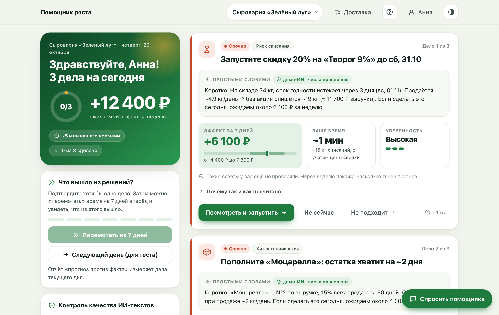
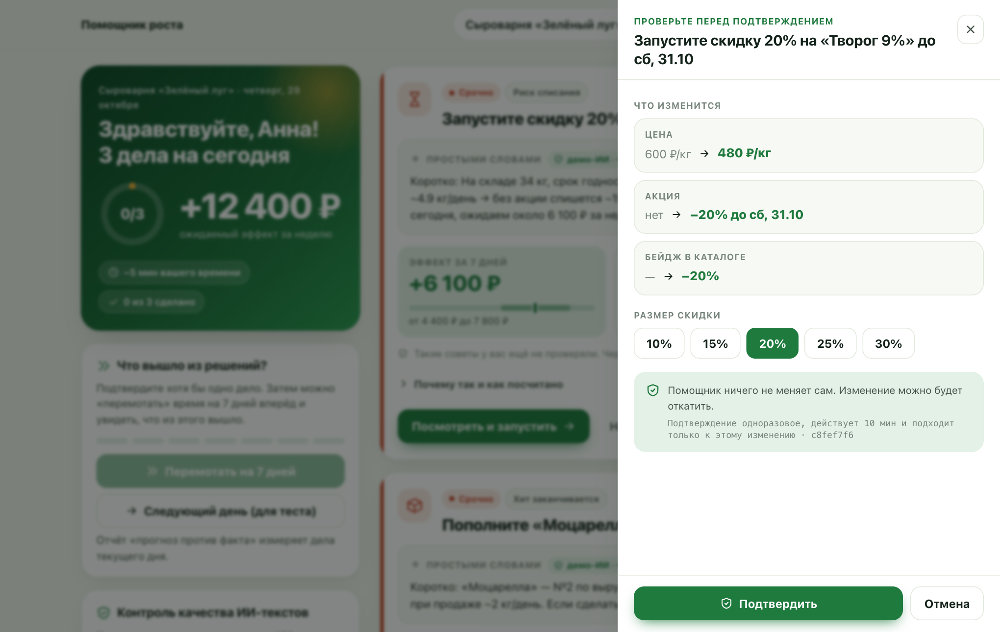
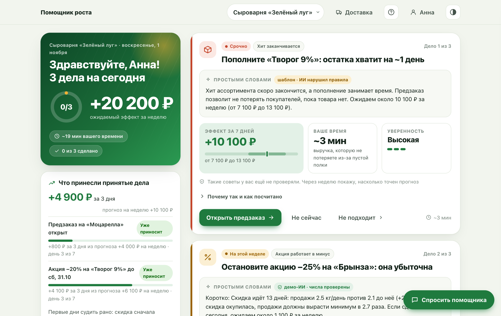
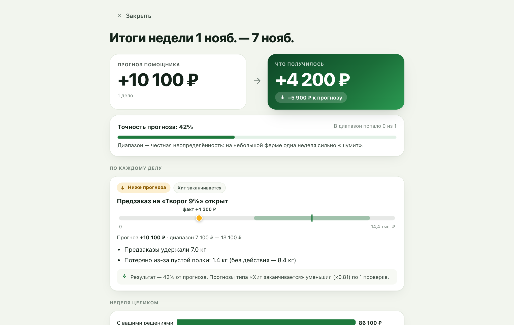
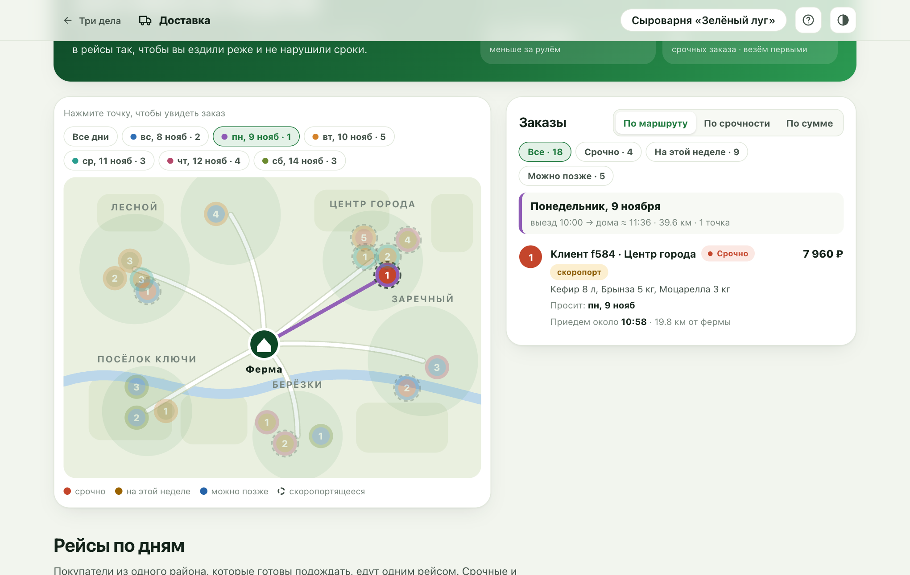

<div align="center">

# Помощник роста фермера

**Каждый день три дела: что сделать, почему и сколько это может принести.**
Помощник ничего не меняет сам: только после подтверждения фермера.

[](https://github.com/FedorSolodkin/Farm-Helper/actions/workflows/ci.yml)


[](LICENSE)

[Как это устроено](docs/design.md) · [Разбор интервью](docs/interview.md)



</div>

## Зачем это нужно

Фермер сам производит, продаёт и возит заказы. На отчёты и графики у него нет времени, ему нужно «что сделать сегодня». Помощник смотрит продажи, остатки, сроки годности, акции и клиентов и выбирает три самых выгодных действия. У каждого есть причина на данных хозяйства, эффект в рублях с диапазоном и кнопка запуска.

Это прототип для кейса «ИИ-помощник роста фермера». Реальных данных у меня нет, поэтому всё работает на синтетических хозяйствах (сыроварня, овощи, мёд) или на ваших CSV.

## Что умеет

| | |
|---|---|
| **Три дела в день** | 11 сигналов (риск списания, заканчивающийся хит, акция в минус, уходящие клиенты и другие) превращаются в действия с эффектом в рублях |
| **Решает фермер** | Превью, одноразовый токен подтверждения, повторная проверка стоп-правил, откат, журнал с цепочкой хэшей |
| **Честный ИИ** | Числа считает код, модель только пересказывает. Каждое число, дата и название сверяются, иначе показывается шаблон |
| **Прогноз против факта** | Через неделю помощник сравнивает обещанное с полученным и поправляет следующие прогнозы |
| **Доставка** | Заказы на карте, рейсы по дням и экономия километров, когда покупатели из одного района едут вместе |
| **Свои данные** | Загрузка пяти CSV-шаблонов, проверка с номерами строк, клиенты сразу заменяются хэшем |
| **Кабинет** | Вход по почте и паролю, всё хранится на вашем компьютере |

## Как это выглядит

<table>
<tr>
<td width="50%"><br><sub><b>Подтверждение.</b> Что именно изменится, размер скидки и одноразовый токен.</sub></td>
<td width="50%"><br><sub><b>Результаты.</b> Что принесли принятые дела с каждым прожитым днём.</sub></td>
</tr>
<tr>
<td width="50%"><br><sub><b>Неделя.</b> Прогноз против факта, и помощник учится на разнице.</sub></td>
<td width="50%"><br><sub><b>Доставка.</b> Карта, порядок остановок и время приезда.</sub></td>
</tr>
</table>

## Быстрый старт

Нужен только Python 3.9 или новее, устанавливать пакеты не нужно.

```bash
git clone https://github.com/FedorSolodkin/Farm-Helper.git
cd Farm-Helper
python3 -m engine.server
```

Откройте http://127.0.0.1:8765, создайте кабинет и выберите готовое хозяйство или загрузите свои данные. На macOS можно запустить двойным щелчком по `start.command`.

Без кабинета (все заходят как гости): `python3 -m engine.server --no-auth`.

### Docker

```bash
docker build -t farm-helper .
docker run -p 8765:8765 farm-helper
```

## Живая модель

По умолчанию ИИ-тексты имитирует демо-модель. Чтобы подключить настоящую, скопируйте `secrets.env.example` в `secrets.env` и впишите значения. Подойдёт любой OpenAI-совместимый API (проверено на Yandex AI Studio):

```bash
cp secrets.env.example secrets.env
python3 -m engine.server --llm env
```

Файл `secrets.env` исключён из git. Не публикуйте ключи.

## Свои данные

В мастере знакомства выберите «Загрузить свои данные». Обязательны три файла: товары, остатки и продажи, не меньше 14 дней истории. Просмотры карточек и акции добавляются по желанию. Кнопка «Подставить пример» заполняет шаблоны, чтобы было видно формат.

## Тесты

```bash
python3 -m unittest discover -s tests -t .
```

Проверяют сигналы, стоп-правила, подтверждение и откат, проверку ИИ-текстов, перемотку недели, доставку, кабинеты и импорт.

## Структура

```
engine/    логика на чистом Python: сигналы, приоритеты, подтверждение, ИИ-тексты, доставка, сервер
web/       экран «Три дела» и страница «Доставка» (HTML без сборки)
tests/     автотесты
tools/     сборка плоской папки для обычного хостинга
docs/      как это устроено и разбор интервью
```

Автоматические проверки на каждый пуш настроены в `.github/workflows/`.


## Автор и лицензия

[FedorSolodkin](https://github.com/FedorSolodkin). Код распространяется по лицензии [MIT](LICENSE).
